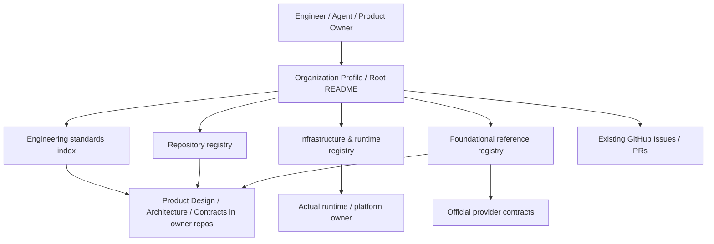

# Engineering Registry & Governance — Architecture

**Status:** Draft (To-Be; Sponsor review not completed)  
**Owner:** `retailpulses/.github` Engineering  
**Product Design:** [design.md](design.md), requirements ERG-001–ERG-008  
**Current State:** [CURRENT_STATE.md](CURRENT_STATE.md) (historical source-inspection snapshot, not runtime verified)  
**Standards:** [Documentation Standard §§14–18](engineering/DOCUMENTATION_STANDARD.md)  
**Tracking:** [Issue #25](https://github.com/retailpulses/.github/issues/25) · [Issue #42](https://github.com/retailpulses/.github/issues/42)

## 1. Goals, boundaries & constraints

The Engineering Registry is an **index and documentation product**, not a central database or running service. It helps an Engineer or Agent discover the correct asset, responsible Owner, trusted source, state and evidence from existing repositories and platforms (ERG-001–008 / WF-01–04).

**Non-goals:** new asset DB, background synchronizer, duplicated Issue tracker, live monitoring service, second governance engine, automatic redistribution of agent instructions, or central ownership of product schemas/runtime data.

## 2. System context and components (logical To-Be)

- **Organization indexes (this repo):** navigation, identifiers, documented ownership, time-scoped observations and cross-references.
- **Product repositories:** product design, technical mappings, executable schema, implementations, tests and product-specific runtime contracts.
- **Actual platforms:** operational records, secrets, installed runtime version and real-time behavior; registry observations cannot replace read-back.
- **Governance:** the actual governance tool implementation remains with [rp-governance-kit](https://github.com/retailpulses/rp-governance-kit) until an explicit verified authority cutover (ERG-005).

## 3. Logical data model, ownership & lifecycle

No application-specific SQLite/PostgreSQL schema is required for this Registry. Its data model is a **set of linked, version-controlled documentation/index records**, with exact YAML/Markdown fields owned by the existing index files.

| Logical entity | Meaning / relationship | Canonical source and authority |
| --- | --- | --- |
| Repository / Product Owner | Stable identity and responsibility; owns many Assets | [Repository Registry](registry/README.md), [repositories.yaml](registry/repositories.yaml); repository itself owns its product facts |
| Engineering Asset / Reference | Discoverable standard, template, infrastructure item or API contract; links to Owner, Source and consumers | [engineering](engineering/README.md), [infrastructure](infrastructure/README.md), [references](references/README.md) according to domain |
| Runtime / Workspace / Release | Distinct operational and source identities; link to time-stamped observations | [runtime inventory](infrastructure/mac-mini/runtime-inventory.yaml), [workspace mapping](infrastructure/mac-mini/workspaces.yaml); actual authority belongs to platform |
| Observation / Verification Evidence | Time-, environment- and scope-bound support for an assertion; **not** a live state | Existing platform evidence, dated snapshots, Issue/PR links; keep provenance |
| Migration / Authority Decision | Source → destination → validation → explicit ownership cutover | Existing GitHub Issues/PRs, especially [#25](https://github.com/retailpulses/.github/issues/25); no parallel migration DB |

**Relationships / integrity expectations:** each discovered asset has a stable linkable identifier and a distinguishable Owner or explicit `Unknown`; reference items link to official source or verified internal authority; Observations have an associated scope/date/source and do not replace current platform facts. Several consumers may link to one canonical asset, but two independent editable copies must not both assert ownership. Migration should preserve source traceability and old aliases until consumers are checked.

**Read/write boundaries:** Maintainers edit documents through reviewed Git changes; Agent read paths include README/index links. These files do not grant access to external source repositories, provider systems or production databases. Actual data modifications must follow each system's permissions and change rules.

**Lifecycle:** Proposed/Registered → Partially Verified/Verified (within stated scope) → Stale/Superseded/Retired when applicable. In-flight Issue/PR progress remains outside the Registry. Old records should be linked or marked retired only after traceability and consumer validation. No universal retention period applies to index metadata; secret/customer data must never be copied into registry files.

**Exact contracts:** Machine-readable index fields and their constraints remain in the linked YAML/Markdown source; PR reviews and applicable validation determine compatibility. Where data contracts become consequential, link existing schema or add bounded TRD in the owning repository rather than reproducing YAML here.

## 4. Target deployment & integrations

GitHub repository and GitHub Organization Profile are the publishing surface. No server/worker/cron or new credentials are needed for this docs-only product. Links may refer to external systems but do not mirror or automatically synchronize those systems. GitHub API availability, permissions and rate limits are external dependencies. Export/rollback means Git revert or restoring a previously known commit; this is not a database restore strategy.

| Component | Target | Validation |
| --- | --- | --- |
| Registry and standards pages | GitHub repository tree | Links resolve and displayed ownership/status match authoritative record |
| Structured registry files | Current YAML/Markdown under owner directory | Syntax/reference consistency and diff review; runtime evidence separate |
| External platforms | Existing authorized owners | Read-only source/permission/freshness check when a live statement is needed |
| Agent instructions | Explicitly loaded `AGENTS.md` and repo-local guidance | Verify actual runtime loader; never infer automatic inheritance |

## 5. Failure modes, quality and evidence

- **Stale observations:** show timestamp/coverage, label Unknown and obtain new read-back before a live decision.
- **Broken/renamed links:** maintain aliases or revise navigation in the same PR; do not silently repoint to a noncanonical copy.
- **Authority collision:** stop cutover, identify current Owner and preserve both source records until decision and consumer verification.
- **Sensitive material:** do not embed secrets, raw customer records, children's transcripts or runtime credentials in Git indexes.
- **Acceptance:** starting from Org Profile, locate the corresponding Owner and evidence for ERG-001–008; demonstrate incorrect or missing data is explicitly shown as Unknown rather than fabricated.

## 6. Maturity and remaining unknowns

| Fact | Status | Evidence / unresolved condition |
| --- | --- | --- |
| Current repositories and linked indexes exist | Source-inspected; current runtime **UNKNOWN** | [Current State](CURRENT_STATE.md); read main before operational use |
| Current governance owner stays in rp-governance-kit | Specified; cutover Open | [Issue #11](https://github.com/retailpulses/.github/issues/11) |
| External platform live inventory is complete | Open | [Issues #14](https://github.com/retailpulses/.github/issues/14) and [#15](https://github.com/retailpulses/.github/issues/15) |
| All external reference fields verified | Open | [Issue #19](https://github.com/retailpulses/.github/issues/19) |
| Agent guidance is automatically loaded by all runtimes | **Not assumed** | Must verify on specific Agent/runtime |

**No deployment or schema change is performed by this documentation migration.** The technical schema truth remains where it was; this Architecture provides logical relationships and constraints only.
